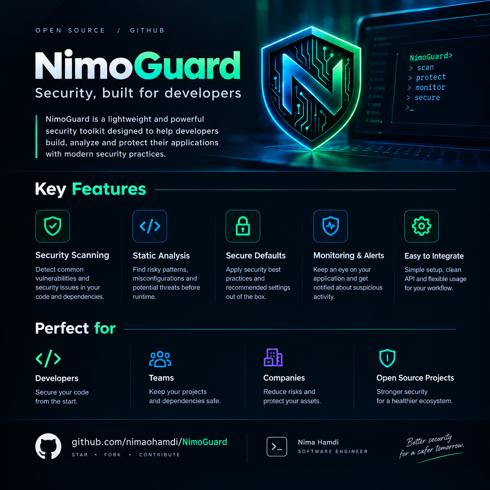
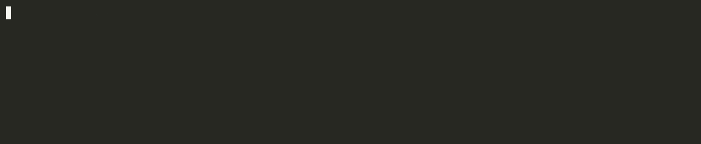

<div align="center">

  

  <h1>NimoGuard</h1>

  <p>Secure Authorization Firewall for AI Agents & MCP</p>

  

  <br />

  

</div>

---

A **capability-based, default-deny authorization firewall for MCP servers and AI agents**, with both a policy engine and real, strict enforcement, not just advice.

NimoGuard sits between an AI agent and the actions it can take on its own. It works two ways:

1. **As an MCP proxy**: it sits in front of a real MCP server; every `tools/call` is checked before it reaches the upstream (next layer) server. It is configured with a JSON file, started with one command, and supports optional human approval through a webhook and a persistent audit log.
2. **As a guarded execution layer**: `guardedReadFile`, `guardedWriteFile`, `guardedFetch`, and `guardedExec` only perform the real file read, file write, network request, or shell command **if the policy allows it**. Otherwise nothing happens: no file is touched or changed, no process is spawned.

Anything not explicitly granted is denied. Every decision can be audited.

## Why

AI agents act on your machine and network. Prompts are not a security
boundary: an agent that can call a tool will eventually be tricked into
calling it the wrong way. NimoGuard puts an explicit, testable policy layer
in front of the action itself, and it **fails closed**: invalid input, bad
dates, failed approvals, and logging failures all result in `DENY`.

## Architecture

```
Agent → NimoGuard (proxy or guarded functions) → real action (file, network, process, MCP server)
```

| Package | Role |
|---|---|
| `@nimoguard/core` | Shared types: Action, Decision, Capability, AuthorizationRequest |
| `@nimoguard/capabilities` | Matcher: does a request fall inside a capability's scope? |
| `@nimoguard/policy` | `authorize(request, capabilities, now?)`, a pure function |
| `@nimoguard/audit` | `authorizeAndAudit`, `authorizeWithApproval`, a webhook approval handler, and pluggable sinks (in-memory, JSONL file) |
| `@nimoguard/mcp-proxy` | An MCP server that authorizes and forwards `tools/call` to an upstream MCP server, plus a config-driven CLI |
| `@nimoguard/enforce` | `guardedReadFile` / `guardedWriteFile` / `guardedFetch` / `guardedExec`: real enforcement, not just a decision |

Design decisions:

- **Pure core.** `authorize` has no side effects. Logging and approval live in separate layers.
- **Injected clock.** The current time is a parameter, so tests never depend on the real clock.
- **Fail closed everywhere.** If the audit sink throws, even an `ALLOW` becomes `DENY`. If an approval handler throws, times out, or returns garbage, the result is `DENY`.
- **No shell in `guardedExec`.** Commands run through `execFile`, never a shell,
  so even if a metacharacter ever slipped past the matcher, there is no shell
  there to interpret it.
- **Deny before contact.** An unrecognized or ungranted tool, file, or command is
  rejected before anything real happens. Upstream servers, the filesystem,
  and child processes are never touched for a denied request.
- **Secrets stay out of config files.** The approval webhook token is read
  from an environment variable named in the config, never stored in it.
- **Sensitive data stays out of the log by default.** Tool arguments are not
  written to the audit log unless you explicitly opt in.

## Try the demos



```bash
pnpm install
pnpm demo                                  # audit-layer demo (ALLOW / DENY / REQUIRE_APPROVAL)
pnpm --filter @nimoguard/mcp-proxy demo    # a real MCP proxy blocking and forwarding tool calls
pnpm --filter @nimoguard/enforce demo      # real disk writes and a real child process, gated live
```

The enforce demo (shown above) actually writes a file to a temp sandbox,
reads it back, runs a real `echo` subprocess, and then shows three attempts
(writing outside the sandbox, running `rm`, chaining a command with `;`)
being blocked before anything happens.

## Running the MCP proxy from a config file

NimoGuard is not published to npm yet. For now, clone and build:

```bash
git clone https://github.com/nimaohamdi/NimoGuard.git
cd NimoGuard
pnpm install
pnpm build
```

Write a config file (see `packages/mcp-proxy/nimoguard.config.example.json`):

```json
{
  "agentId": "agent-1",
  "upstreamServerName": "demo-upstream",
  "upstreamCommand": "node",
  "upstreamArgs": ["/absolute/path/to/upstream-server.js"],
  "capabilities": [
    {
      "id": "cap-echo",
      "agentId": "agent-1",
      "action": "tool.call",
      "scope": "mcp://demo-upstream/echo"
    }
  ]
}
```

Run the proxy:

```bash
node packages/mcp-proxy/dist/cli.js --config /path/to/nimoguard.config.json
```

The config is validated on startup. A missing file, invalid JSON, an unknown
`action`, or a capability without a `scope` prints a clear error and exits
with code 1. Nothing starts in a half-configured state.

Then point any MCP client that supports stdio servers at the proxy instead of
the real server:

```json
{
  "mcpServers": {
    "my-tool-via-nimoguard": {
      "command": "node",
      "args": [
        "/path/to/NimoGuard/packages/mcp-proxy/dist/cli.js",
        "--config",
        "/path/to/nimoguard.config.json"
      ]
    }
  }
}
```

Use absolute paths in the config and the client entry: the working directory
of a client-launched process is usually not what you expect.

## Human approval through a webhook

A capability with `"constraints": { "requireApproval": true }` does not run
on its own. Without an approval handler it is blocked. With one, a human (or
your internal approval service) decides.

Add an `approval` block to the config (see
`packages/mcp-proxy/nimoguard.config.approval.example.json`):

```json
"approval": {
  "webhookUrl": "https://approvals.internal.example.com/nimoguard",
  "timeoutMs": 30000,
  "authTokenEnv": "NIMOGUARD_APPROVAL_TOKEN"
}
```

Set the token in the environment that launches the proxy:

```bash
export NIMOGUARD_APPROVAL_TOKEN=...
```

NimoGuard sends a `POST` with a JSON body and `Authorization: Bearer <token>`:

```json
{
  "requestId": "...",
  "agentId": "agent-1",
  "sessionId": "...",
  "action": "tool.call",
  "resource": "mcp://github/delete_repo",
  "capabilityId": "cap-1",
  "reason": "Matching capability requires approval",
  "metadata": { "arguments": { "repo": "demo" } }
}
```

Your service must answer HTTP 2xx with exactly one of:

```json
{ "approved": true }
```

```json
{ "approved": false }
```

Everything else is treated as a failure and the call is denied: a non-2xx
status, invalid JSON, `"approved": "true"` as a string, a network error, a
redirect, or no answer within `timeoutMs`. Only `https` is accepted (plain
`http` is allowed for localhost only). If `authTokenEnv` names a variable
that is not set, the CLI exits with an error before starting the upstream
server.

The webhook receives the tool arguments (a reviewer needs them to decide),
even when they are kept out of the audit log.

## Persistent audit log

Add an `auditLog` block to write every decision to a file, one JSON object
per line (JSONL):

```json
"auditLog": {
  "path": "/var/log/nimoguard/audit.jsonl",
  "includeArguments": false
}
```

- `path` must be absolute. A client-launched process has an unpredictable
  working directory, so a relative path is rejected at startup.
- If the path is not writable, the CLI exits with an error before the
  upstream server starts. It never runs without the log you asked for.
- The file is created with owner-only permissions (`0600`), its directory
  with `0700`.
- **Tool arguments are not written by default.** They can contain tokens, file
  contents, or personal data. Set `"includeArguments": true` to record them.
- If a write fails while the proxy is running, the request is denied
  (fail-closed): no log, no action.
- An approval-gated call produces two records with the same `requestId`: the
  `REQUIRE_APPROVAL` request, then the final `ALLOW` or `DENY`.

One line looks like this (formatted here for reading):

```json
{
  "requestId": "b305ee9b-5ff6-47a9-8e28-f59d550c2e64",
  "timestamp": "2026-10-20T13:04:11.202Z",
  "request": {
    "agentId": "agent-1",
    "sessionId": "proxy-session-1760965451000",
    "action": "tool.call",
    "resource": "mcp://demo-upstream/read_file"
  },
  "decision": {
    "decision": "DENY",
    "reason": "No matching capability",
    "requestId": "b305ee9b-5ff6-47a9-8e28-f59d550c2e64"
  }
}
```

## Quick example (guarded execution)

```ts
import { guardedReadFile, AuthorizationError } from "@nimoguard/enforce";

const capabilities = [
  {
    id: "cap-1",
    agentId: "agent-1",
    action: "filesystem.read",
    scope: "/workspace/project/**",
  },
];

try {
  const content = await guardedReadFile(
    "agent-1",
    "/workspace/project/../.ssh/id_rsa",
    capabilities,
  );
} catch (err) {
  if (err instanceof AuthorizationError) {
    console.log(err.decision, err.reason);
    // "DENY" "No matching capability", and the file was never opened.
  }
}
```

## What is enforced today

- **Filesystem scopes:** paths are normalized (`path.posix.normalize`), so
  traversal like `/workspace/project/../.ssh/id_rsa` is rejected. Relative
  paths and null bytes are rejected. `/workspace/project2` does not match
  `/workspace/project/**`.
- **Symlinks:** the guarded file functions resolve the real path and check it
  against the scope again, so a symlink inside an allowed directory that
  points outside it is denied.
- **Network scopes:** the resource is parsed with `new URL()`. Only `https:`
  is allowed, URLs with userinfo are rejected, and the hostname must match the
  scope exactly, so `api.github.com.evil.com` and
  `https://api.github.com@evil.com/` are denied.
- **Command scopes:** only the first token of the command is matched against
  the scope, and any shell metacharacter (`` ; & | ` $ ( ) { } < > `` or a
  newline) anywhere in the command denies it outright. `git status; rm -rf /`
  is rejected even though it starts with an allowed binary.
- **MCP tool scopes:** a scope like `mcp://github/create_issue` grants one
  tool on one server; `mcp://github/*` grants every tool on that server.
- **Expiry:** expired, exactly-expiring, and unparseable `expiresAt` are all denied.
- **Human-in-the-loop:** `REQUIRE_APPROVAL` is resolved by an approval handler
  (a webhook in the CLI). A rejection, error, or timeout is a `DENY`.
- **Real enforcement, not just a decision:** the MCP proxy and the
  `@nimoguard/enforce` functions actually gate the real action. A blocked
  file write never touches disk, a blocked command never spawns a process, a
  blocked tool call never reaches the upstream MCP server.

## Status

| Area | State |
|---|---|
| Filesystem matcher (with symlink re-check in guarded functions) | Done |
| Network matcher (exact https host) | Done |
| Command matcher (first token + shell metacharacter guard) | Done |
| MCP tool matcher (exact + server wildcard) | Done |
| Expiring capabilities | Done |
| Audit logging (fail-closed) | Done |
| Persistent JSONL audit log from the CLI config | Done |
| Human approval (`authorizeWithApproval`, webhook handler) | Done |
| MCP proxy (stdio, forwards `tools/list` and `tools/call`) | Done |
| Config-file-driven proxy + validated CLI, including approval and audit log | Done |
| Guarded fs/network/exec enforcement (`@nimoguard/enforce`) | Done |
| Published to npm | Not yet (clone and build) |
| Approval flow in `@nimoguard/enforce` | Not implemented (proxy only) |
| `RiskLevel` (automatic risk scoring) | Not implemented |

131 unit and integration tests, all passing in CI.

## Threat model

NimoGuard assumes the agent is **untrusted** and the policy author is trusted.

Mitigated:

- Path traversal (`..`), relative paths, null bytes
- Prefix-lookalike paths (`/workspace/project2`)
- Symlink escape through the guarded file functions
- Lookalike hosts and userinfo tricks in URLs
- Command chaining, piping, substitution, redirection, and backgrounding
- Lookalike MCP server names, and cross-server leakage via wildcard scopes
- Expired or malformed capabilities
- Malformed config files (rejected at startup)
- Silent audit failure (logging errors deny the request)
- Secrets leaking into the audit log through tool arguments (off by default)
- Approval service failure: errors, timeouts, redirects, and malformed answers deny
- Tool-name enumeration: an unrecognized tool is denied before the upstream
  server is ever contacted
- Shell injection in `guardedExec`: commands run via `execFile`, never a shell

## Known limitations

- **The audit log is not tamper-evident and has no rotation.** It is a plain
  append-only file. Anyone with write access to it can edit it, and it grows
  without bound. Ship it to a write-once store and rotate it with your usual
  tooling (for example `logrotate` with `copytruncate`).
- **Approval requests are authenticated with a bearer token only.** There is no
  request signing, so your approval service should only be reachable from the
  proxy's network and should treat `requestId` as single-use.
- **TOCTOU:** the file system can change between the authorization check and
  the actual use. The symlink re-check narrows this window but does not
  eliminate it.
- **No wildcards for network hosts:** network scopes are exact hostnames only.
- **Library-level enforcement, not a sandbox:** the MCP proxy and guarded
  functions enforce policy for any code that calls through them. They cannot
  stop code that bypasses them entirely and calls `fs`, `fetch`, or
  `child_process` directly. That would require an OS-level sandbox (seccomp,
  containers, etc.), which is out of scope for this project.
- **The proxy wraps one upstream server per process.** To guard several MCP
  servers, run one proxy per server.

## Development

```bash
pnpm install
pnpm -r test
pnpm demo
pnpm --filter @nimoguard/mcp-proxy demo
pnpm --filter @nimoguard/enforce demo
```

## License

MIT